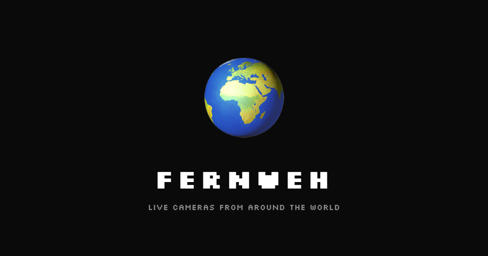

# Fernweh

<p align="center">
  
</p>

> **Fernweh** /ˈfɛʁnˌveː/ — German, *noun*
>
> From *fern* ("far, distant") + *Weh* ("pain, ache"). Literally "far-sickness" — an ache for distant places, a longing for somewhere you have never been. The opposite of homesickness.
>
> The term was coined by Prince Hermann von Pückler-Muskau in his 1835 book *The Penultimate Course of the World of Semilasso: Dream and Waking*, during the Romantic period when artists and writers were deeply drawn to exploring the boundaries of human emotion.
>
> While *Wanderlust* describes a joyful desire to travel, *Fernweh* conveys something deeper — a pain, a pull toward the unknown. It is the feeling of being homesick for a place you have never visited.
>
> — [BBC: The travel 'ache' you can’t translate](https://www.bbc.com/travel/article/20200323-the-travel-ache-you-cant-translate)

---

**🌍️🌍️🌍️Live Demo:** https://ubiquitous-o.github.io/Fernweh/ 🌍️🌍️🌍️

A fullscreen web app that automatically cycles through YouTube live cameras — every minute by default, or at any interval you set. Hosted on **GitHub Pages** with video data refreshed by **GitHub Actions**.

## Controls

| Key | Action |
|-----|--------|
| Click (screen) | Skip to next camera |
| `Space` / `→` / `N` | Skip to next camera |
| `F` / `F11` | Toggle fullscreen |
| Mouse move | Show the control buttons (top centre; on a portrait screen too narrow for that, the right edge): next camera, settings |
| `Esc` / click outside | Close the settings panel |

## Features

- Orbit transition between live streams: the view rises to an inclined satellite orbit around a realistic whole Earth (real-time day/night terminator, clouds with shadows, mountain relief, city lights, atmospheric scattering), then dives into a pillar of light standing at the next camera's location (WebGL)
- Streams with no known location get no pillar: the readout raises a navigation error and the camera spins down into a crash on some distant land, whiting out into the stream
- Realistic sky behind the Earth: a star field and the Milky Way that turn as the camera orbits, with the Sun, the Moon and the five naked-eye planets at their real positions (the Moon shows its real phase)
- Corner globe showing the camera location: the same realistic Earth as the orbit view (real-time day/night, city lights), with the camera circling it above the equator and a pillar of light at the location; a tag with the place name and local time is tied to the pillar by a leader line
- Location detection from video title/channel/description ([Gemini API](https://ai.google.dev/) batch extraction + dictionary-first matching + fallback) with [Nominatim](https://nominatim.openstreetmap.org/) geocoding
- Dictionary-first optimization: skips Gemini API for known locations, saving RPD quota
- Auto-learning from geocache: previously resolved locations are merged into the dictionary at startup, reducing Gemini calls over time
- Full video description fetching via YouTube videos.list API for improved location accuracy
- Camera local time & time difference from your timezone (via [geo-tz](https://github.com/evansiroky/timezone-boundary-builder) at build-time)
- Clock and 7-day weather forecast overlay (via [Open-Meteo](https://open-meteo.com/)) — off by default, turn it on in the settings panel
- Geolocation-based weather (browser Geolocation API → IP fallback → Tokyo fallback); your location is only looked up once the clock & weather overlay is turned on
- Randomized search queries with multiple patterns for maximum discovery (300+ locations, 50+ topics)
- Clickable video title — links to original YouTube video, resumes on browser back
- Settings panel: show or hide each overlay (clock & weather, local time & globe, live badge, video info), set how often the camera switches, toggle fullscreen; choices are saved in the browser. Everything is shown by default except clock & weather
- Long channel names and video titles scroll sideways (marquee) instead of being cut off
- "City, Country" location labels on globe (auto line-break at comma)
  - **Note:** Globe labels are best-effort — location detection relies on video titles, channel names, and AI extraction, so labels may be inaccurate or missing for some streams
- Client-side video pool refresh every 2 hours (follows server-side updates)
- Auto-switch with progress bar — 1 minute after a camera comes on by default; pick an interval from 1 minute to 24 hours with the +/- buttons in the settings panel (applied when the panel closes)
- Auto-retry on playback failures
- Kiosk-friendly — Silkscreen bitmap font, cursor auto-hides, burn-in prevention

## Architecture

```
[GitHub Actions cron (every 2 hours)]
  → YouTube Data API v3 search (8 queries/run)
  → public/videos.json → git push

[GitHub Pages (static hosting)]
  → public/index.html + public/videos.json

[Browser]
  → Loads video candidates from videos.json
  → YouTube IFrame Player API for playback
  → Corner globe (the orbit view's Earth renderer): the camera orbits the Earth; a light pillar marks the location, linked by a leader line to a tag with the place name and local time
  → Camera local time + time difference (from timezone in videos.json)
  → Orbit view (WebGL textured Earth + stars, Sun and Moon) with a dive into the camera location during loading / switching
  → Geolocation API / IP API → Open-Meteo for weather

[Location Detection (build-time)]
  → Load geocache.json → merge into dictionary (auto-learning)
  → Dictionary match first (hardcoded + learned locations)
  → Fetch full descriptions via YouTube videos.list API
  → Unmatched items → Gemini API batch (gemini-2.5-flash-lite, 20/batch)
  → Gemini result → dictionary coords or Nominatim geocoding
  → Fallback → dictionary match on title/channel
  → Nominatim cache → scripts/geocache.json (feeds next run's dictionary)
  → geo-tz: coords → IANA timezone → videos.json

[Location Detection (runtime fallback)]
  → Title/channel → KNOWN_LOCATIONS dictionary match
```

## Setup

### 1. Get a YouTube Data API v3 Key

1. Go to [Google Cloud Console](https://console.cloud.google.com/)
2. Create a project
3. Enable **YouTube Data API v3** under APIs & Services > Library
4. Create an API key under APIs & Services > Credentials

### 2. Get a Gemini API Key (Free)

1. Go to [Google AI Studio](https://aistudio.google.com/apikey)
2. Create an API key (no credit card required)

### 3. Configure GitHub

1. Go to your repo's **Settings > Secrets and variables > Actions**
2. Add secrets:
   - `YOUTUBE_API_KEY` = your YouTube API key
   - `GEMINI_API_KEY` = your Gemini API key (optional — falls back to dictionary-only matching)
3. Go to **Settings > Pages** and set source to the `main` branch, `/public` folder (or `/ (root)`)
4. Go to **Actions** and manually trigger "Fetch Live Videos" to seed initial data

### 4. Done

The site will be live at `https://<username>.github.io/<repo>/`.
Videos are refreshed every 2 hours automatically.

## Local Development

```bash
# Fetch videos locally
YOUTUBE_API_KEY=your_key node scripts/fetch-videos.js

# Serve the static site
npx serve public
```

Open the site with `?test=unknown` (for example `http://localhost:3000/?test=unknown`) to treat every stream as location-unknown and try the crash transition.

## Local Server Mode (Optional)

For dedicated hardware (N100 kiosk, Raspberry Pi, etc.), the Express server is still available:

```bash
cp config.example.json config.json
# Edit config.json with your API key
npm install express
npm run start:local
```

## API Quotas

**YouTube Data API v3**
- 8 searches/cron × 100 quota = 800 quota/run
- 1 videos.list/cron × 1 quota/video ≈ 50–100 quota/run
- Every 2 hours × 12 runs/day ≈ **~10,000 quota/day** (near free tier limit)

**Gemini API (gemini-2.5-flash-lite)**
- 0–1 batch request/run (skipped when all items are dictionary-matched)
- Max 12 runs/day = **≤12 requests/day** (free tier: 20 RPD)

## Project Structure

```
fernweh/
├── public/                       # GitHub Pages root (uploaded as-is by deploy-pages.yml)
│   ├── index.html                # DOM + SVG glitch filter, loads css/styles.css and js/main.js
│   ├── css/
│   │   └── styles.css            # All styling
│   ├── img/                      # Earth textures for the orbit view (day / night lights / water mask / clouds / height)
│   ├── js/                       # ESM modules (no bundler; served as separate files)
│   │   ├── main.js               # Entry — orchestrates init, dynamically loads YT IFrame API
│   │   ├── state.js              # Shared mutable state
│   │   ├── dom.js                # Cached DOM element refs
│   │   ├── orbit.js              # Orbit-view veil: camera choreography (ascend / dive to location)
│   │   ├── orbitRenderer.js      # WebGL renderer for the orbit view: stars, Milky Way, Sun, Moon, planets, textured Earth, light pillars
│   │   ├── orbitTexturePreviews.js # Tiny embedded Earth textures shown until the full images load
│   │   ├── glitch.js             # SVG-filter video glitch animation
│   │   ├── player.js             # Single YT.Player wrapper + loadVideoById
│   │   ├── transitions.js        # switchVideo / resumeVideo flow (pre-glitch → orbit ascend / dive → post-glitch)
│   │   ├── videoPool.js          # videos.json pool, watched-list, fetchNext
│   │   ├── locations.js          # Runtime KNOWN_LOCATIONS dictionary fallback
│   │   ├── ui.js                 # Info (with marquee) / loading / error / fullscreen toggle
│   │   ├── entities.js           # Decodes HTML entities in titles (shared with scripts/)
│   │   ├── settings.js           # Settings panel: overlay visibility toggles + switch interval, saved in localStorage
│   │   ├── progress.js           # Switch timer (interval from settings) + progress bar
│   │   ├── clock.js               # Local clock + camera local time
│   │   ├── weather.js             # Geolocation → Open-Meteo 7-day forecast
│   │   ├── globe.js               # Corner globe: realistic Earth seen from an orbiting camera, with a light pillar at the location
│   │   ├── input.js               # Mouse / keyboard / click handlers
│   │   └── burnin.js              # Periodic overlay shift (kiosk burn-in prevention)
│   └── videos.json               # Video candidates (generated by Actions)
├── scripts/
│   ├── fetch-videos.js           # Orchestrator: search → describe → resolve → write videos.json
│   ├── lib/
│   │   ├── youtube.js            # search / videos.list / filter / query generator
│   │   ├── locations.js          # LOCATION_COORDS, LABELS, BLOCKLIST, dictionary matcher
│   │   ├── geocode.js            # Nominatim client + geocache.json (with auto-learning)
│   │   ├── gemini.js             # Batch location extraction via Gemini API
│   │   ├── timezone.js           # geo-tz wrapper (coords → IANA timezone)
│   │   └── resolveLocation.js    # 3-stage: Gemini → dict/geocode → title/channel fallback
│   ├── geocache.json             # Nominatim cache (feeds next run's dictionary)
│   └── test-single-video.js      # Debug helper: exercises the real lib path on one video
├── .github/workflows/
│   ├── fetch-videos.yml          # Cron workflow (every 2 hours)
│   └── deploy-pages.yml          # GitHub Pages deployment
├── server.js                     # Express server (optional local/kiosk mode)
├── config.example.json           # Config template (local mode)
├── setup.sh                      # Kiosk auto-start setup script
├── autostart.sh                  # Kiosk launch script (chromium)
├── fernweh@.service              # systemd service unit (kiosk mode)
├── package.json
└── README.md
```

The frontend uses native ES modules (`<script type="module">`) — no build step. Files in `public/` are uploaded verbatim by `deploy-pages.yml`, so adding a new module is just dropping it into `public/js/` and importing it.

## Credits

- Earth textures in `public/img/` are NASA imagery (Blue Marble, Black Marble / Earth at Night, cloud cover, topography), taken from the example assets of [three-globe](https://github.com/vasturiano/three-globe) and [globe.gl](https://github.com/vasturiano/globe.gl) (both MIT). The night-lights and water-mask images were resized to 2048×1024; the cloud image is the alpha channel of the original PNG, saved as a 2048×1024 grayscale JPEG.
